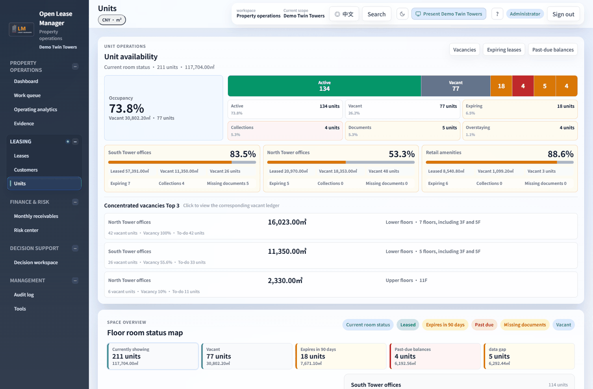
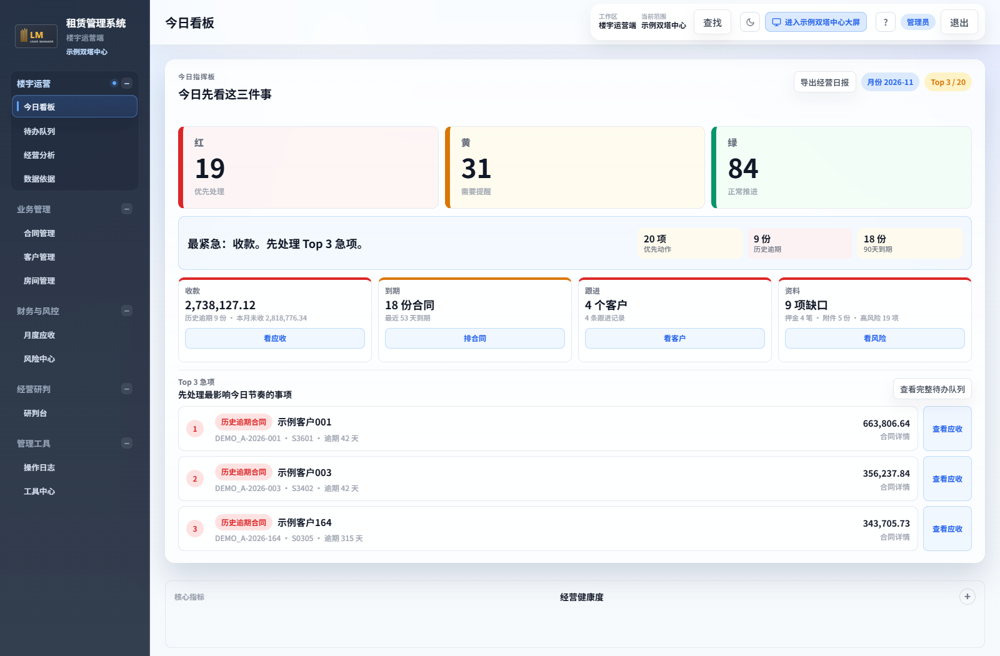
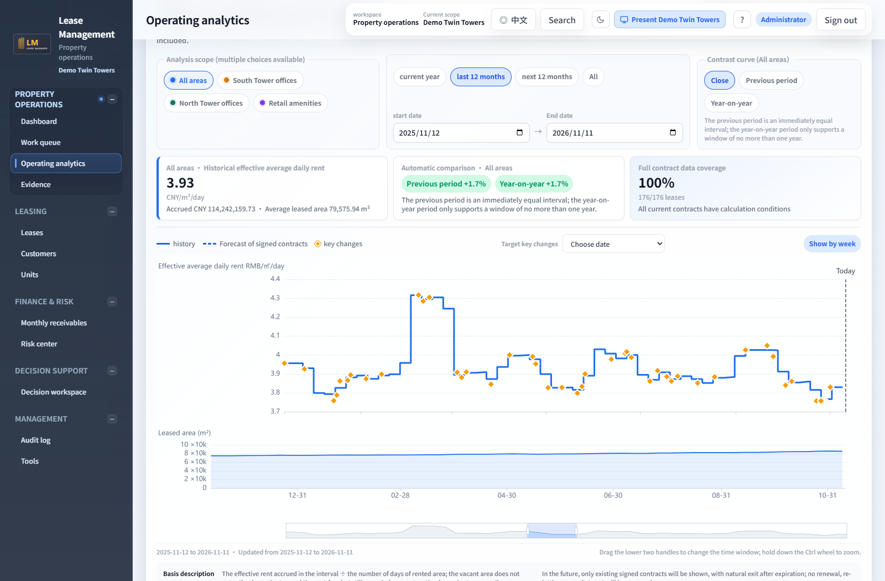
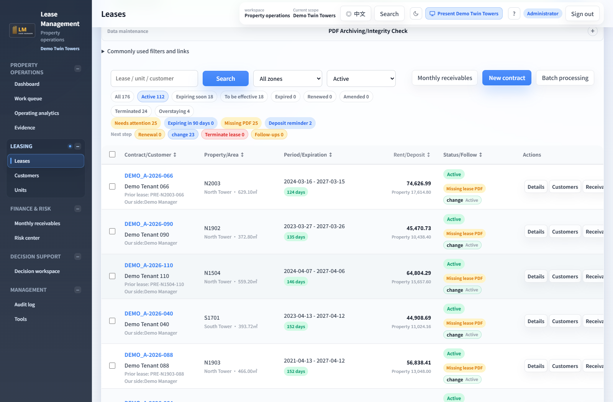

# Open Lease Manager

**English** | [简体中文](README.zh-CN.md)

An open-source, self-hosted system for multi-building lease and property operations: lease registers, monthly receivables, payment allocation, customer follow-up and portfolio analysis.

Built with FastAPI, SQLite, Alembic, Vue 3 and ECharts. Released under the MIT License.

**Developed over approximately six months with assistance from OpenAI Codex, using GPT-6 Astra for recent development.**

## What's included in v2.3.0

- Buildings, zones and leasable units, with separate workflows for detailed operations and published operating snapshots.
- Contracts, rent terms, escalations, rent-free periods, deposits and attachments.
- Monthly receivables, partial payments, payment allocation, invoice records and collection follow-up.
- Customer records, follow-ups, risk indicators, an operating dashboard and rent timeline analysis.
- Financial forecasts, expense plans, version comparisons and finance handoff; this does not provide automatic posting into accounting software.
- Role-, building- and capability-based access, audit trails, backups and recovery.
- Optional AI-assisted explanations, disabled by default. Enabling them sends the relevant operating data to the model service you configure.

## Language and units

English / 简体中文, m² / ft², and a choice of viewing currencies. Original records stay in the book currency; reference conversions show their rate date.

## Screenshots



These screenshots come from an isolated demo installation. Buildings, customers, contracts and amounts are synthetic; no real business records are included. The UI shown here is in English. Click an image to view it at full size.

**Operations dashboard** — Prioritize collections, expiring leases, customer follow-ups and missing documents.



**Rent timeline analysis** — Explore effective daily rent, leased area and contract changes by date and property zone.



**Contract management** — Review lease status, dates, units, rent and deposits, then open the relevant workflow.



**Unit occupancy** — Compare occupancy by property zone and identify vacancy concentrations, expiring leases and flagged units.


## Deploy with Docker Compose

Requires Docker Engine / Docker Desktop with Compose, plus Python 3. The first build needs network access to download dependencies and build the image.

```sh
git clone https://github.com/Evostructs/OpenLeaseManager.git
cd OpenLeaseManager
python scripts/configure.py
docker compose up -d --build --wait
```

Open http://127.0.0.1:8080 and create your administrator on the initialization page. There is no default account or password.

The default configuration listens only on localhost. Create the administrator before allowing external access. For public access, configure an HTTPS reverse proxy and set `COOKIE_SECURE=true` in `.env`. Adjust `LEASE_BIND_ADDRESS` if LAN access is needed. Do not expose an uninitialized instance to the internet.

Data is stored in the Docker named volume `lease-data`. Stop the application with `docker compose down`; **do not use `down -v`, which deletes the data volume**. Application backups are stored in the same volume, so regularly download backups through the administration page and keep a separate off-host copy. Never commit `.env`, keys, databases or attachments to a public repository.

First startup initializes five generic example buildings, permissions and metric definitions. It does not import real tenants, contracts, receipts or personal data. The example buildings illustrate different operating structures and can be adjusted through administration features. Demo scripts modify data and must only be used in an isolated demonstration environment.

## Local development

Use Python 3.12 and Node.js 22:

```sh
python -m venv .venv
# Windows: .venv\Scripts\activate
# macOS / Linux: source .venv/bin/activate
python -m pip install --require-hashes -r requirements.lock
python scripts/configure.py
cd frontend
npm ci
npm run build
cd ..
python -m uvicorn app.main:app --host 127.0.0.1 --port 8080
```

## Verification

```sh
python -m pip install --require-hashes -r requirements-dev.lock
cd frontend
npm ci
npm test
npm run build
cd ..
python -m pytest -q
```

GitHub Actions also checks the backend, frontend, container build and startup with a fresh data volume. Browser end-to-end tests require Playwright browsers and explicit opt-in with `LEASE_E2E=1`.

## Versions and upgrade limitations

Version 2 uses generic building identifiers and is intended for fresh installations. **Do not attach a v1 or private-deployment database directly to v2.** Cross-version business-data migration has not been verified. Back up the source system, then design and validate a migration in an isolated environment. Earlier releases remain available under Releases.

This repository does not include private runtime environments, internal deployment history, production databases, contract attachments, corporate logos or private configuration. Fixed passwords and encryption examples in tests are isolated test fixtures, not deployment credentials.

## Why we built Open Lease Manager

The project started with contracts and units: keeping lease dates, rent, occupancy status and related documents together so they were easier to find and check.

Receivables, payments, deposits and customer follow-ups came next. Supporting multiple buildings also meant agreeing on metric definitions, setting access boundaries and making data sources clear. The system then grew to include operating analysis, budgets, forecasts and finance handoff.

Along the way, we kept returning to everyday details: preventing duplicate entries, protecting unsaved work, keeping historical calculations traceable and reducing loading times. As the system grew, these details needed just as much attention as new features.

We made the project open source so others with similar needs can use it and adapt it to their own work, spending less effort finding records, checking figures and handling routine tasks.

## Feedback and contributions

Issues and pull requests are welcome. Do not upload screenshots, logs or databases containing customer information, personal data or access credentials. Do not disclose secrets or identifiable business data in public Issues.
