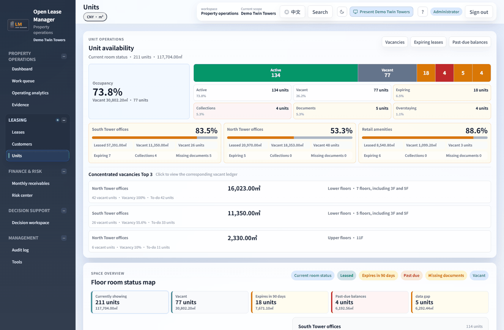
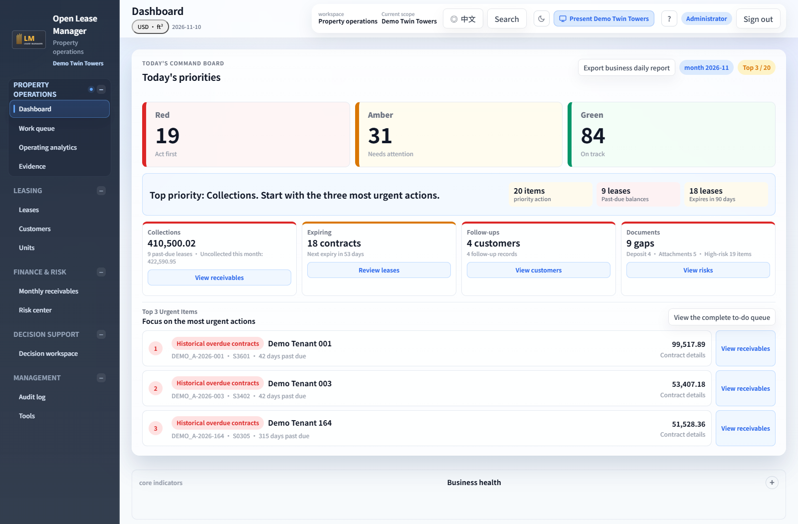
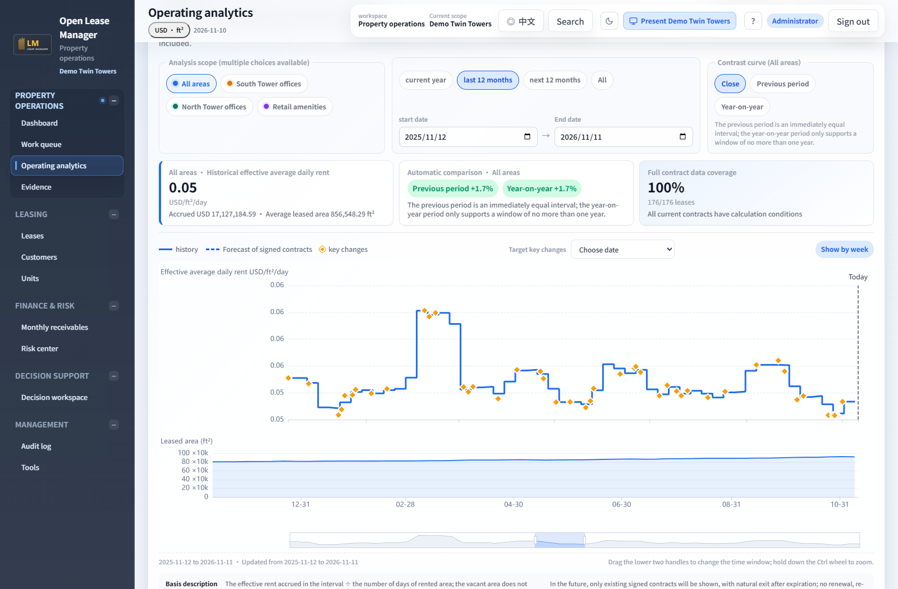
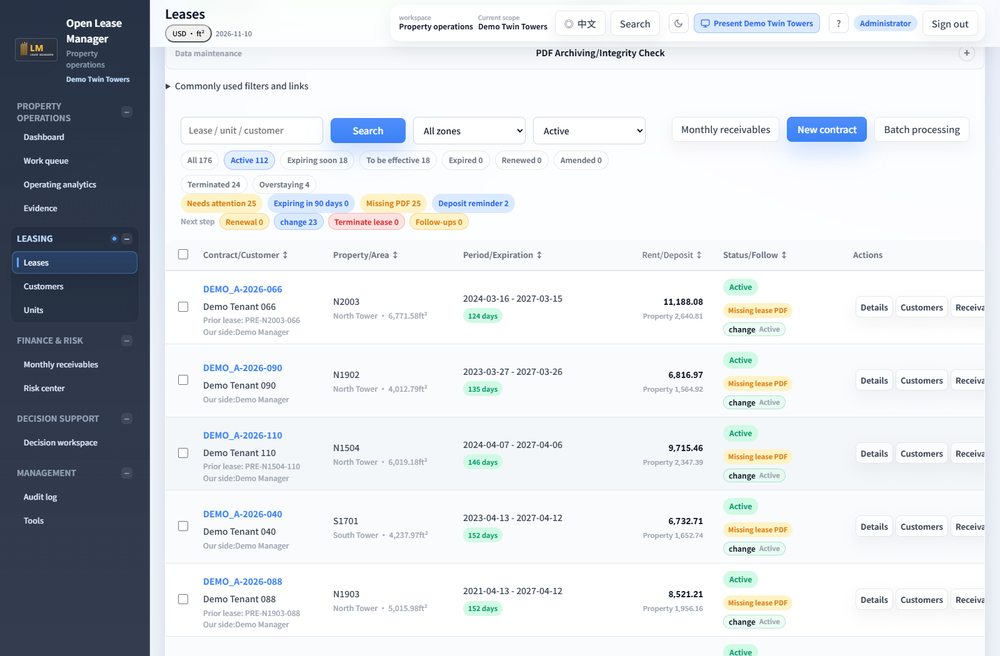

# Open Lease Manager

[English](README.md) | **简体中文**

开源、自托管的多楼宇租赁与资产运营管理系统。适用于租赁台账、月度应收、收款核销、客户跟进和资产组合分析。

基于 FastAPI、SQLite、Alembic、Vue 3 和 ECharts，采用 MIT 许可证。

## v2.3.0 的主要功能

- 多楼宇、分区和房间管理，区分明细运营与已发布经营快照。
- 合同、租金条款、递增、免租期、押金和附件管理。
- 月度应收、部分收款、收款核销、开票与催收记录。
- 客户档案、跟进记录、风险提示、经营驾驶舱和租金时间分析。
- 财务预测、费用计划、版本比较和财务交接；不等同于财务软件自动记账。
- 按角色、楼宇和能力配置权限，保留操作审计，支持备份恢复。
- 可选 AI 辅助解释，默认关闭；启用后会向你配置的模型服务发送相应经营数据。

## 语言与单位

支持中英文、平方米／平方英尺及查看币种切换。原始账目保留记账币种，汇率折算注明日期。

## 界面预览



以下截图来自独立演示环境，楼宇、客户、合同和金额均为模拟数据，不含真实业务记录。以下展示英文界面，点击图片可查看大图。

**经营看板**：集中查看收款、合同到期、客户跟进和资料缺口，优先处理待办事项。



**租金时间分析**：按日期和分区查看有效平均日租金、在租面积与合同变化。



**合同管理**：查看合同状态、租期、房源、租金与押金，并进入具体业务操作。



**房态管理**：对比分区出租率，查看空置集中区域、即将到期及需关注的房源。


## 使用 Docker Compose 部署

需要 Docker Engine / Docker Desktop（含 Compose）及 Python 3。首次部署需联网下载依赖并构建镜像。

```sh
git clone https://github.com/Evostructs/OpenLeaseOps.git
cd OpenLeaseOps
python scripts/configure.py
docker compose up -d --build --wait
```

访问 http://127.0.0.1:8080 ，在初始化页面创建自己的管理员。没有默认账号或默认密码。

默认只监听本机，完成管理员初始化后再开放外部访问。公网使用应配置 HTTPS 反向代理，并在 `.env` 中设置 `COOKIE_SECURE=true`；需要局域网访问时可调整 `LEASE_BIND_ADDRESS`。不要在尚未创建管理员时将服务直接暴露到公网。

数据保存在 Docker 命名卷 `lease-data` 中。停止服务使用 `docker compose down`；**不要使用 `down -v`，这会删除数据卷**。系统备份位于同一数据卷内，应定期通过管理页面下载备份并保存到另一处。`.env`、密钥、数据库和附件不得提交到公开仓库。

首次启动会创建五个通用示例楼宇及必要的权限、指标定义，不会导入真实租户、合同、收款或个人数据。示例楼宇用于展示不同运营结构，可通过管理功能调整。演示脚本会修改数据，仅可在独立演示环境中使用。

## 本地开发

使用 Python 3.12 和 Node.js 22：

```sh
python -m venv .venv
# Windows: .venv\Scripts\activate
# macOS / Linux: source .venv/bin/activate
python -m pip install --require-hashes -r requirements.lock
python scripts/configure.py
cd frontend
npm ci
npm run build
cd ..
python -m uvicorn app.main:app --host 127.0.0.1 --port 8080
```

## 验证

```sh
python -m pip install --require-hashes -r requirements-dev.lock
cd frontend
npm ci
npm test
npm run build
cd ..
python -m pytest -q
```

GitHub Actions 另外检查后端、前端、容器构建及全新数据卷启动。浏览器端到端测试需安装 Playwright 浏览器并显式启用 `LEASE_E2E=1`。

## 版本与升级边界

v2 使用通用示例楼宇标识，面向全新部署。**不要将 v1 或内部部署的数据库直接挂载到 v2**；跨版本业务数据迁移尚未验证，应先备份并在独立环境中设计和验证迁移。旧版发布仍保留在 Releases 中。

本仓库不包含内部运行环境、内部部署历史、生产数据库、合同附件、公司标志或私人配置。测试中的固定口令和加密样例仅用于隔离测试，不是部署凭据。

## 反馈与贡献

欢迎提交 Issue 或 Pull Request。请勿上传包含客户信息、个人信息或访问凭据的截图、日志和数据库。安全问题请勿在公开 Issue 中披露密钥或可识别业务数据。
